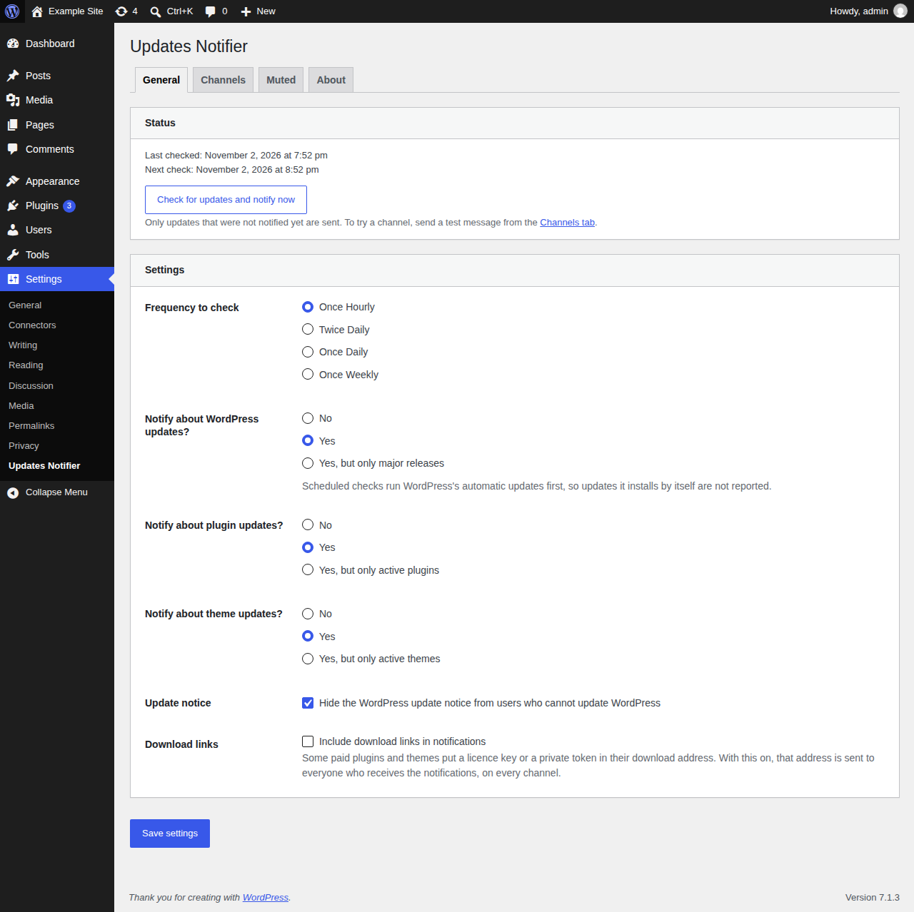

# WP Updates Notifier

[](https://github.com/l3rady/wp-updates-notifier/actions/workflows/ci.yml)
[](https://github.com/l3rady/wp-updates-notifier/actions/workflows/lint.yml)
[](https://scorecard.dev/viewer/?uri=github.com/l3rady/wp-updates-notifier)
[](https://www.bestpractices.dev/projects/16308)
[](https://wordpress.org/plugins/wp-updates-notifier/)
[](https://wordpress.org/plugins/wp-updates-notifier/)
[](LICENSE)

Tells you by email when your WordPress site has core, plugin or theme updates waiting, so you know without logging in. Useful for sites you rarely visit and for sites you look after for clients.

The plugin's website, with the documentation, is at **<https://wpun.cariss.dev>**.

- Checks on a schedule (hourly, twice daily, daily or weekly) and tells you about each new version once.
- Core, plugin and theme updates, optionally only for active plugins and themes.
- Email to one or more addresses.
- A signed JSON webhook for Zapier, Make, n8n, Home Assistant or your own code, which also says when a reported update has been installed.
- Hooks for developers to change what is checked and what is sent.

Requires WordPress 6.7 or newer and PHP 7.4 or newer.



## Installing

- **WordPress.org (recommended):** search for "WP Updates Notifier" under Plugins → Add New, or download it from [wordpress.org/plugins/wp-updates-notifier](https://wordpress.org/plugins/wp-updates-notifier/).
- **Composer:** through [WordPress Packagist](https://wpackagist.org/): `composer require wpackagist-plugin/wp-updates-notifier`.
- **Zip:** each [GitHub release](https://github.com/l3rady/wp-updates-notifier/releases) has the plugin zip attached; upload it under Plugins → Add New → Upload Plugin.

Then open **Settings → Updates Notifier** to choose where notifications go.

**Try it first:** the [Live Preview on WordPress.org](https://wordpress.org/plugins/wp-updates-notifier/?preview=1) opens the plugin in [WordPress Playground](https://wordpress.github.io/wordpress-playground/), a throwaway site in your browser with made-up pending updates and two email channels already set up. Emails are caught, not sent: Tools → Demo emails shows them.

Checks run on WP-Cron, which only runs when the site gets visits. On a quiet site, set `DISABLE_WP_CRON` and run `wp updates-notifier check` from a real cron job. The [documentation](https://wpun.cariss.dev/) has the details.

## Documentation

- **Using the plugin:** the [user guide](https://wpun.cariss.dev/latest/users/).
- **Writing an add-on:** add-ons can add notification channels, item types, routing rules and configuration sources through a public, versioned API. Start with the [developer guide](https://wpun.cariss.dev/main/developers/) and the [example add-on](examples/wpun-example-channel/).
- **Working on the plugin:** the [contributor guide](https://wpun.cariss.dev/main/contributing/) and the rules in [CONTRIBUTING.md](CONTRIBUTING.md).

Changes are listed in [CHANGELOG.md](CHANGELOG.md).

## Help, bugs and security

- Questions: the [support forum](https://wordpress.org/support/plugin/wp-updates-notifier/).
- Bugs and ideas: [GitHub issues](https://github.com/l3rady/wp-updates-notifier/issues).
- Security problems: please report them privately, see [SECURITY.md](SECURITY.md).
- Verifying a download: see [Verifying a release](SECURITY.md#verifying-a-release).

## Development

Docker is the only requirement: no PHP, Composer or Node on the host.

```sh
make up      # local sites on :8080 and :8081
make test    # the WordPress suites and the build and release script tests
make help    # every target
```

The [contributor guide](https://wpun.cariss.dev/main/contributing/) has the rest.
