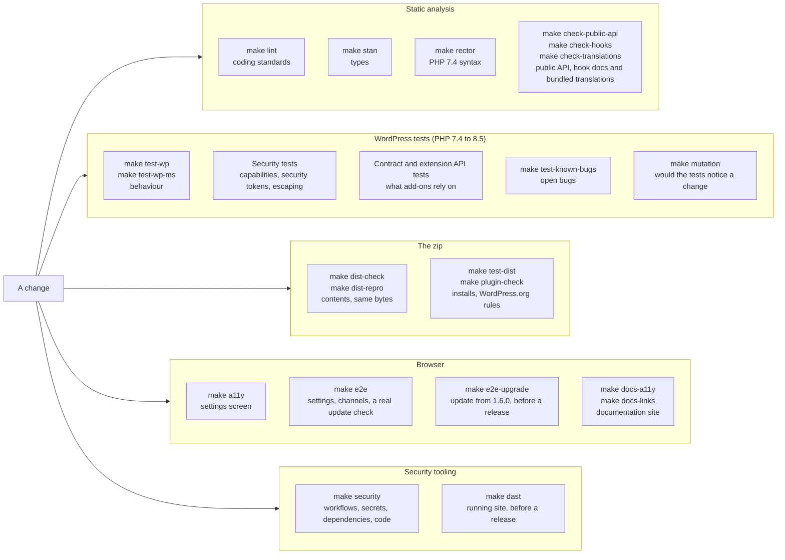

# Tests and checks

The plugin has several layers of tests and checks. Each one catches a different kind of mistake, and each one runs with a `make` target in Docker, so you need only Docker and `make`. `make test` runs `test-wp` and `test-wp-ms` (the WordPress suites, single site and multisite), `test-release`, `test-readme`, `test-blueprint` and `test-wporg-assets`. The other layers have their own targets.

The rules for tests (a bug fix needs a failing test, the coverage and mutation floors only go up, how to handle a surviving mutant) are in [CONTRIBUTING.md](https://github.com/l3rady/wp-updates-notifier/blob/main/CONTRIBUTING.md). This page is how to run and read each layer.



CI runs most of the targets in the diagram on pull requests, but not all of them. `make dast` (about 11 minutes), `make mutation` (about 35 minutes), `make e2e-upgrade` (it downloads 1.6.0 from WordPress.org) and `make test-known-bugs` (those tests are expected to fail) never run in CI, and neither do `make screenshots` and `make blueprint-smoke`, which are not in the diagram. Run the first three before each release (see [Releases](releases.md)). A pull request also runs only the jobs its changes can affect: `make e2e` and `make e2e-ms`, for example, run only on pull requests that touch the plugin or the files the browser checks use. [CONTRIBUTING.md](https://github.com/l3rady/wp-updates-notifier/blob/main/CONTRIBUTING.md) says which checks a pull request runs and how the gate jobs work.

Pick the PHP and WordPress versions with `PHP_VERSION` and `WP_VERSION` (a wordpress-develop tag, or `trunk`):

```sh
make test-wp WP_VERSION=6.7.9 PHP_VERSION=7.4
```

## WordPress tests

**Covers.** Behaviour of the plugin inside a real WordPress: the update check, scheduling, settings and validation, channels and routing, the email channel, the settings screen markup, upgrades from older versions and uninstall. WordPress, its test library and a database come from the Docker setup. There is no real network (every HTTP request must be faked or the test fails) and no real mail.

**Lives in.** `tests/wp/`, one `test-*.php` file per area, on `tests/wp/class-wpun-test-case.php`. Add a file there and it runs: they are found by name.

**Run it.** `make test-wp` for a single site, `make test-wp-ms` for multisite. Pass PHPUnit options with `ARGS`, for example `make test-wp ARGS="--filter Test_Routing"`. `PHP_VERSION` and `WP_VERSION` pick the versions.

**Multisite.** The multisite run has the plugin network-activated, as a network has it. A test class that needs the plugin as one site's copy (the dormant mode, or per-site settings) sets `protected $network_activated = false;` in `WPUN_Test_Case`. `set_network_activated()` switches it inside a test.

**CI.** The `wordpress` job in `ci.yml` runs PHP 7.4 to 8.5 on WordPress 7.1.3, single site and multisite, and PHP 7.4 and 8.3 on WordPress 6.7.9, the oldest supported. On a pull request that cannot affect everything it runs fewer legs (PHP 7.4 and 8.5, single site only). The `wordpress-trunk` job runs the suite against WordPress trunk every night, on PHP 7.4 and 8.5.

## Coverage

**Covers.** Which lines of the shipped code (`wp-updates-notifier.php`, `uninstall.php`, `includes/` and `modules/`; files no test loads count as uncovered) the WordPress suite runs.

**Run it.** `make coverage` runs the WordPress suite twice with pcov, as a single site and as a multisite (PHP 8.3 unless `PHP_VERSION` says otherwise). The code for networks only runs in the multisite suite and the code for single sites only in the first, so `bin/coverage-merge.php` counts the two runs together. It prints the summary and the five least covered files, writes `build/coverage/clover.xml` and an HTML report in `build/coverage/html/`, and fails when line coverage is below `COVERAGE_MIN`. `bin/coverage-check.php` computes the percentage from the Clover report, and `tests/bin/test-coverage-check.sh` tests it. The pcov image is a separate Docker stage, so `make test-wp` is unchanged.

**The floor.** `COVERAGE_MIN` is set in the `Makefile`; it was measured at 97.12% over both suites when last raised. Try a value without editing the file with `make coverage COVERAGE_MIN=98`. The floor only goes up, and [CONTRIBUTING.md](https://github.com/l3rady/wp-updates-notifier/blob/main/CONTRIBUTING.md) says how to raise it.

**CI.** The `coverage` job in `ci.yml` runs `make coverage` on PHP 8.3 and WordPress 7.1.3 for every pull request that changes code or tests, and keeps the report as the `coverage-report` artifact for 14 days. It is in `ci-gate`, the required check, so a pull request below the floor cannot merge.

## Mutation testing

**Covers.** Whether the WordPress tests would fail if the shipped code were wrong. [Infection](https://infection.github.io/) changes the code one small step at a time (a `>` becomes `>=`, a `continue` becomes `break`, a call is removed), runs the tests that cover the changed line, and reports the changes no test fails on. A mutant that no test fails on has survived: either a test is missing, or the change is one nobody can observe. Coverage says a line ran; this says a test would notice if it were wrong.

**Lives in.** `infection.json5` at the root: the shipped code, the default mutators, the floors, and the mutants that are ignored with a reason. `docker/mutation.sh` runs it in the `wp-tests-coverage` image, where Infection is a pinned and checked PHAR (`INFECTION_VERSION` and `INFECTION_SHA256` in `docker/Dockerfile`, with the steps to verify a new release). It is not a Composer dependency: it needs PHP 8.2, and the project's Composer platform is PHP 7.4. The tests are the WordPress suite, so it needs no tests of its own; a surviving mutant is fixed with a test in `tests/wp/`.

**Run it.**

```sh
make mutation                                            # everything: about 35 minutes with the default 4 threads on a 16-core machine
make mutation THREADS=12                                 # more or fewer PHPUnit processes at once (4 by default)
make mutation ARGS="--filter=includes/class-state.php"   # one file (--filter also takes a directory); a few minutes
make mutation ARGS="includes/class-state.php includes/class-routing.php"   # several files
```

The report is `build/infection/infection.log`: every surviving mutant with a diff (`summary.log` and `summary.json` count them). Each PHPUnit process Infection starts gets its own table prefix (`TEST_TOKEN`, see `docker/wp-tests-entrypoint.sh`), so the processes share one database without touching each other's tables. `make test-wp` is unchanged.

**The floors.** `minMsi` and `minCoveredMsi` in `infection.json5`; `make mutation` fails below them. MSI counts the mutants of lines no test runs as missed, covered MSI only those the tests run. The scores were 92.98% (MSI) and 93.52% (covered MSI) when the floors were set, on 5322 mutants of which 150 are ignored. Two full runs of the same code differed by about a point (timing under load), so the floors sit a point below the score. Try a value without editing the file with `make mutation ARGS="--min-msi=95"`.

**Baseline.** 5322 mutants: 4792 killed, 5 timed out and 12 errored (these count as detected), 333 survived, 30 not covered by any test and 150 ignored; the 35 minutes were with 4 threads. The code that decides whether a notification is sent (what was notified, the active-only filter, routing, reminders, validation of settings, the cron schedule and its repair) scores about 99% when run alone, and no survivor is left there unless it is ignored with a reason. The survivors left are mostly in the channel form, channel store, field renderer and field type code.

**Survivors.** Read a survivor's diff in the log. What to do with it (write the test, or ignore it with a reason) and when to raise the floors are rules: they are in [CONTRIBUTING.md](https://github.com/l3rady/wp-updates-notifier/blob/main/CONTRIBUTING.md), which also says never to change the plugin to make a mutant go away.

**Known limits.** It runs a single site, so multisite-only lines are ignored. A lone `continue` line is never marked as run by pcov, so those mutants are reported as not covered. Code that runs only while WordPress loads, before any test starts (the plugin's hook registration), is mapped to the few tests that boot the plugin again, which is why `tests/wp/test-hooks.php` boots a fresh `Plugin` and checks each hook.

**CI.** None: it takes over 45 minutes on a GitHub runner. Run it on your machine before each release (see [Releases](releases.md)), and on the files you changed when you work on the tests.

## Security tests

**Covers.** Hostile input and access control: the capability and security token matrix for every admin action, stored and reflected cross-site scripting through names, versions, URLs and settings, secrets that must never reach the page or a log, malformed settings input, and outbound requests. These tests back the [threat model](../security/threat-model.md).

**Lives in.** `tests/wp/security/`, in the `security` PHPUnit group. They are found automatically, so a new admin action or setting gets a new test in this folder, not a change to a list.

**Run it.** They run with the rest of the WordPress tests. To run only them: `make test-wp ARGS="--group security"`.

**CI.** The same `wordpress` jobs as above. The scanners and the other security checks are on [Security checks](security-checks.md).

## Known-bug tests

**Covers.** A bug that is open and has a test. The test asserts the correct behaviour, so it fails until the bug is fixed.

**Lives in.** `tests/wp/test-known-bugs.php`. A test is tagged `@group known-bug` while its bug is open. `phpunit.xml.dist` leaves that group out of the normal run, so CI stays green. The fix removes the tag, and the test then runs with everything else and guards against the bug coming back. The group can be empty, which means no known bug has a test waiting.

**Run it.** `make test-known-bugs` runs only the tagged tests. They are expected to fail.

**CI.** No. They are excluded on purpose.

## Contract and extension API tests

**Covers.** What other code depends on. The contract tests pin the names and behaviour that existing sites and add-ons use: option names, hook names, the public classes. The extension API tests load a fixture add-on that uses every extension point (channels, item types, routing, configuration sources, the API version check) and the example channel from `examples/`, so the documented way to extend the plugin is exercised as an add-on author would use it. Changing one of these tests needs an upgrade path and a changelog entry.

**Lives in.** `tests/wp/test-contract.php`, `tests/wp/test-extension-api.php` and `tests/wp/test-example-channel.php`. The fixture add-on is in `tests/fixtures/plugins/wpun-test-addon/`.

Two checks guard the same boundary without WordPress. `make check-public-api` fails if a module, the example channel or the fixture add-on uses anything that is not public API. `make check-hooks` fails if a hook the plugin fires has no doc block with `@since`, or if the [hook reference](../developers/hooks.md) is stale (`make hook-docs` rewrites it). Both have their own tests in `tests/bin/`, which the targets run first, so a checker that stopped finding problems would fail too.

`make check-translations` guards the bundled translations: it fails if a `.l10n.php` file has a string of the code untranslated, a fuzzy or obsolete entry, a broken placeholder, wrong plural forms, or is not byte for byte what the translations and the code build (a hand edit, or a changed string). It also fails when WP-CLI warns about a string, and on any other file in `languages/`. So a change to a string needs a translation session before CI is green. Its exporter has its own test in `tests/bin/`, which the target runs first. See [Translations](translations.md).

**CI.** The tests run in the `wordpress` jobs. The checks run in the `phpcs` job of `lint.yml`.

## Static analysis

**Covers.** Mistakes found without running the code.

- `make lint` runs PHP_CodeSniffer with the WordPress Coding Standards on the plugin, the example add-on and the field showcase. Warnings fail it too. `make fix` fixes what phpcbf can.
- `make stan` runs PHPStan at level 8 with the WordPress stubs. `phpstan-baseline.neon` lists the findings that are accepted for now. It may only shrink: fix a new finding, or annotate it with a reason.
- `make rector` is a dry run that shows any PHP 7.4 syntax upgrade Rector would make. It changes nothing. It fails when the code is behind.
- `make taint` (Psalm) and `make sast` (Semgrep) are on [Security checks](security-checks.md).

**Lives in.** `phpcs.xml.dist`, `phpstan.neon.dist`, `rector.php` and `phpstan-baseline.neon` in the repository root.

**CI.** `phpcs` in `lint.yml` (with the two checks above), and the `phpstan` and `rector` jobs in `ci.yml`.

## Packaging

**Covers.** The zip that users install, as opposed to the repository: that its contents are on the allowlist, that it is reproducible, that it installs, activates, deactivates and uninstalls, that WordPress.org's Plugin Check passes, and that the generated `readme.txt`, the Live Preview blueprint and the WordPress.org assets are valid. `make smoke` and `make matrix` check PHP, the `mysqli` extension and that every PHP file lints, on one PHP version or on every supported one. `make test-release` rehearses the scripts the release workflow runs: the copyright year and the signed commit request.

**Lives in.** `bin/` for the scripts, `tests/bin/test-release-scripts.sh` for the release rehearsal. Each target, and what it checks, is on [Packaging](packaging.md).

**CI.** `ci.yml` has a job for each: `smoke` (every PHP version), `dist` (PHP 7.4 and 8.5, which also runs `make test-dist`), `dist-repro`, `plugin-check` (with `check-headers`, `test-readme`, `test-blueprint`, `check-blueprint`, `test-wporg-assets` and `wporg-assets-check`) and `release-scripts`.

## Browser checks

**Covers.** Accessibility in a real browser, with Playwright and axe: WCAG 2.2 A and AA, and keyboard use. And the flows a person goes through, from the browser to the mail they get. Playwright is pinned by image digest and npm lockfile in `tests/e2e/`: keep the image tag and `@playwright/test` at the same version.

### Accessibility of the settings screen

`make a11y` (about 40 seconds) builds a throwaway site as its own compose project (`wpun-e2e`, from `tests/e2e/compose.yml`; it never touches `make up`) and runs Playwright from the official image against the settings screen: axe scans of every view for WCAG 2.2 A and AA, and keyboard checks of the Channels list and a channel form. Specs are in `tests/e2e/specs/`. Any violation fails the run and is listed with its rule, elements and help text. The HTML report is `tests/e2e/reports/html/index.html` (the `a11y-report` artifact when CI fails). Also check new markup by keyboard and with a screen reader: automated checks find only part of the problems.

### End-to-end flows

`make e2e` (about 1 minute) drives the plugin the way a user sees it, on a throwaway site of its own (compose project `wpun-flows`, files in `tests/flows/`; it touches neither `make up`, `make a11y` nor `make screenshots`). It uses the offline fake pending updates of `.wordpress-org/blueprint/fake-updates.php` (shared with the screenshots and the Playground blueprint) and Mailpit to catch the mail. The cases, one spec file each in `tests/flows/specs/`:

- Activation schedules the update check.
- The General tab saves, shows an invalid value's error on its own field and logs no console error.
- An email channel is added, edited, tested (the test message arrives), duplicated, disabled, enabled and deleted.
- A real `wp cron event run sc_wpun_update_check` sends the expected email (subject, every item, no HTML entities). A core-only channel gets only the WordPress item, a second run sends nothing, **Check for updates and notify now** shows the right notice, and a due daily reminder repeats what is waiting.
- A value set by a constant is read-only on the form and is the one used when sending.
- The fixture add-on (`tests/fixtures/plugins/wpun-test-addon`) appears in the module picker.

The Playwright image has no WP-CLI, so the specs call a small server in the WP-CLI container (`tests/flows/control.php`, on the private network only) that runs real `wp` commands. Each test starts by putting the site back to a known state (`resetSite` in `tests/flows/specs/helpers.js`: it clears the run state, stores the channels and settings the test names, removes `SC_WPUN_` constants from `wp-config.php`, restores the plugins and empties Mailpit), so the specs do not depend on each other, on their order or on the time of day. A new flow gets a case in `tests/flows/specs/`. Mail is polled in Mailpit with a timeout, never waited for with a sleep.

`E2E_KEEP=1 make e2e` leaves the site up to look at. `FLOWS_ARGS=runs.spec.js make e2e` runs one file.

### End-to-end flows on a multisite

`make e2e-ms` (about 1 minute) repeats the core path on a multisite with the plugin network-activated (compose project `wpun-flows-ms`, from `tests/flows/compose.yml` plus `tests/flows/compose.multisite.yml`, so it can run beside `make e2e`). It checks the settings in the Network Admin stored as network options, one check on the main site, one email that names the network, "active only" counting a plugin active on a sub-site, and a check left on a sub-site clearing itself. It runs only `tests/flows/specs/network.spec.js`. CI runs it with `make e2e`.

### Upgrade from 1.6.0

`make e2e-upgrade` (about 1 minute) is the upgrade test (#89, #90): it builds the zip with `make dist` and updates the real 1.6.0 from WordPress.org to it, because the main file was renamed and there is no migration stub. It has its own site (compose project `wpun-upgrade`, files in `tests/flows/upgrade/`, never touches `make up`) that does not mount the repository:

- `setup.sh` installs WordPress and 1.6.0 from WordPress.org, so it needs the network.
- `package.php` copies the zip of `make dist` with its Version header set to 2.0.0 (only the copy is changed) to where the web server serves it.
- A must-use plugin offers that copy as the update of `wp-updates-notifier/class-sc-wp-updates-notifier.php`, as WordPress.org would, and WordPress's own updater does the rest.

Each test starts from a fresh, configured 1.6.0 (`reset.php`: the 1.x options `notify_to`, `notify_from`, Slack on, a daily check) and updates it one way: `wp plugin update` (WP-CLI, `Plugin_Upgrader`), "update now" on the Plugins screen (admin-ajax) and the background auto-updater (`wp_maybe_auto_update()`, which can roll an update back in WordPress 6.6 and later). It checks that the plugin ends at 2.0.0 and deactivated (the Plugins screen says so), with no PHP fatal error and no rollback. It then activates the plugin again with `wp plugin activate` and checks that:

- the email settings became the `email` channel with the same address;
- the Slack settings are kept, the Slack notice shows, and its email is sent once;
- the leftover 1.x update check event is kept as the one daily event (not doubled, not stuck in the past);
- a real run mails the migrated address.

It needs the network, so CI does not run it. `E2E_KEEP=1` leaves the site up; `FLOWS_ARGS=update-cli.spec.js` runs one file.

### Screenshots

`make screenshots` (about 30 seconds) is not a test: it regenerates the WordPress.org screenshots, `.wordpress-org/screenshot-1.png` to `screenshot-6.png`, on a throwaway site of its own (compose project `wpun-shots`, files in `tests/screenshots/`; it touches neither `make up` nor `make a11y`). The data is made up: example.com addresses, and fake plugins whose updates and offline update data come from `.wordpress-org/blueprint/fake-updates.php` (shared with the Playground blueprint). Mailpit catches the update email. It fails if the update check did not send.

It runs the update check once from WP-CLI before the browser opens any page, and mutes a few items afterwards (`tests/screenshots/seed-mutes.sh`, plus one mute set in code). Then it photographs the General tab, the Channels list, a channel's form, the Muted tab and the email. A second run breaks the site on purpose (`tests/screenshots/seed-health.sh`: an overdue check, a failed delivery, a channel without its module, WP-Cron off) and photographs Tools → Site Health. The captions are in `.wordpress-org/readme/template.txt`, in the same order as `SHOTS` in `tests/screenshots/screenshots.spec.js`. Dates and times in the files are those of the run. CI does not run it.

### Live Preview blueprint

`make blueprint-smoke` (about 2 minutes) runs the generated Playground blueprint in WordPress Playground CLI (compose project `wpun-playground`, files in `tests/blueprint-smoke/`; it never touches `make up`), with the plugin taken from the zip of `make dist` instead of WordPress.org. Playwright then checks that the settings screen shows the demo notice, the Channels tab shows two deliveries as sent, and Tools → Demo emails lists the update emails with the made-up plugins. Playground downloads WordPress on every run, so it needs the network. CI does not run it. See [Packaging](packaging.md) for the blueprint itself.

### The documentation site

`make docs-a11y` builds this documentation site and checks every page in the dark and the light scheme: axe, no request to a third party, visible keyboard focus, and that every Mermaid diagram parses. A syntax error in a diagram fails it, because Mermaid would otherwise draw an error image and the page would still load. Specs are in `tests/e2e/docs/specs/`. `make docs-links` checks the links in the built site and in `README.md`, the generated `readme.txt` and `CONTRIBUTING.md` with lychee, including links to other sites. Internal links and anchors are already checked by the strict `make docs` build. See [Documentation site](documentation-site.md).

**CI.** The `a11y` and `e2e` jobs in `ci.yml` run `make a11y`, and `make e2e` with `make e2e-ms`. The `docs` and `links` jobs in `docs.yml` run the two documentation checks. The `links` job also runs every week, because links to other sites break without a change here.

## Security tooling

The things the PHP tests cannot see (the workflows, committed secrets, vulnerable dependencies, unsafe code patterns and the running site) are checked by `make security` and `make dast`. Both are on [Security checks](security-checks.md), with the targets, the CI jobs and the reports.
