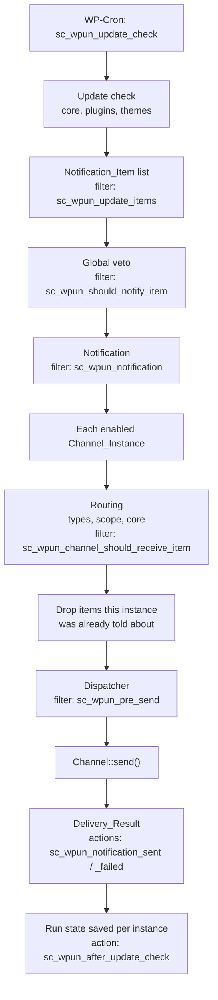

# Architecture

This page follows one update check from start to finish, so you know where your code plugs in.

## The pieces

**Update check.** WP-Cron runs the `sc_wpun_update_check` event at the frequency chosen on the settings screen. The check asks WordPress for core, plugin and theme updates and turns each one into a `WPUN\Notification_Item`. The global settings decide which plugins and themes are looked at (none, all or only active ones).

**Items.** A `Notification_Item` is one thing waiting for an update: its `type` (`core`, `plugin`, `theme` or a type an add-on registers), a `key` that identifies it within the type (the plugin file, the theme stylesheet or `core`), a name, the installed and the available version, links, notes and machine-readable flags such as `active`. Add-ons can add their own items with the `sc_wpun_update_items` filter. See [Item types and routing](item-types-and-routing.md).

**Global veto.** `sc_wpun_should_notify_item` can stop an item from being reported anywhere. A vetoed item still counts as waiting, so its history is kept.

**Notification.** The items are wrapped in a `WPUN\Notification` with the site name, the site URL, the link to the Updates screen and some context, such as whether this is a test message. The `sc_wpun_notification` filter can change it before any channel sees it.

**Channels and instances.** A *channel* is a kind of delivery (the built-in `email`, or one your add-on registers) and is a subclass of `WPUN\Channel`. An *instance* is one configured use of a channel, for example "email to the ops team", stored as a `WPUN\Channel_Instance` with an id, a label, an enabled flag, its field values and its routing. Site owners create instances on the **Channels** tab. Instances can also be defined in code with the `SC_WPUN_CHANNELS` constant or the `sc_wpun_channels` filter. Channels are registered on the `sc_wpun_register_channels` action. A channel that declares an API version the site does not have (`get_api_constraint()`) is refused: it is not registered, `sc_wpun_channel_rejected` fires, and the **Channels** tab, a notice on the settings page and Site Health say why. Its instances are kept, but nothing is sent through them.

**Routing.** Each instance receives only the items its routing allows: which item types, all or only active plugins and themes, and all or only major WordPress releases. The `sc_wpun_channel_should_receive_item` filter adds rules of your own.

**Delivery state.** The plugin remembers, per instance, which version of each item it has told that instance about. An instance is sent only what is new to it. If a send fails, nothing is recorded for that instance, so the same items go out again on the next run, while the instances that succeeded are not sent them twice.

**Dispatcher.** The dispatcher calls your channel's `send()` for one instance and turns whatever happens into a `WPUN\Delivery_Result`. It catches exceptions, so a broken add-on cannot stop the other channels. An instance whose channel is not registered fails as unavailable, with the reason if the module was refused for its API version. `sc_wpun_pre_send` can short-circuit a send. `sc_wpun_notification_sent` and `sc_wpun_notification_failed` fire after each one, and `sc_wpun_after_dispatch` after all of them.

**Results.** The last result of each instance is shown on the Channels tab. Once every instance has had its turn, the run state is saved and `sc_wpun_after_update_check` fires.

## Configuration

Global settings live in the `sc_wpun_settings` option, the instances in `sc_wpun_channels` and the delivery state in `sc_wpun_state`. Read instances through `sc_wpun_channels()`, not the option, so instances defined in code and values from configuration sources are included. Any setting or channel field can instead come from a `wp-config.php` constant, an environment variable or a source your add-on registers. See [Configuration sources](configuration-sources.md).

## Public and internal code

Everything in `includes/` is in the `WPUN` namespace. Classes and methods tagged `@internal` are not part of the public API and can change in any release. Everything else that is documented with `@since` is public; see [Stability and deprecation](stability.md). The built-in email module in `modules/email/` uses only the public API, and CI (`make check-public-api`) makes sure it stays that way.
