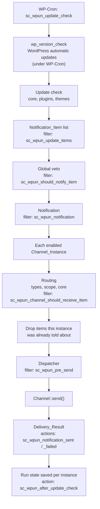

# Architecture

This page follows one update check from start to finish, so you know where your code plugs in.

## The pieces

**Update check.** WP-Cron runs the `sc_wpun_update_check` event at the frequency chosen on the settings screen. You can also run it on demand with `do_action( 'sc_wpun_run_check' )`: it works like a scheduled run, the notification's source is `manual` instead of `cron`, and the schedule is not changed. From a system cron, use `wp updates-notifier check` (see [WP-CLI](../users/wp-cli.md)): it runs the same check with the source `cli`, and has a dry run. The sources are `cron`, `manual` (the action), `cli` (WP-CLI) and `test` (a test message). There is no lock between runs, by design: if a manual run overlaps a scheduled one, both can send the same update before either records it, so a notification can arrive twice. That is rare and harmless for update notices, so the plugin keeps the check simple. A channel that must never deliver twice can keep its own record of what it sent. The check first runs `do_action( 'wp_version_check' )`, whatever the core setting is. Under WP-Cron this lets WordPress run its automatic updates before the plugin and theme updates are read, so what WordPress installs by itself is not reported. Outside WP-Cron it only refreshes the data. See [ADR 0020](../decisions/0020-scheduled-checks-run-wordpress-automatic-updates-first.md). The check then asks WordPress for core, plugin and theme updates and turns each one into a `WPUN\Notification_Item`. The global settings decide what is looked at: WordPress updates (none, all or only major releases), plugins and themes (none, all or only active ones).

**Items.** A `Notification_Item` is one thing waiting for an update: its `type` (`core`, `plugin`, `theme` or a type an add-on registers), a `key` that identifies it within the type (the plugin file, the theme stylesheet or `core`), a name, the installed and the available version, links, notes and machine-readable flags such as `active`. Add-ons can add their own items with the `sc_wpun_update_items` filter. See [Item types and routing](item-types-and-routing.md).

**Global veto.** `sc_wpun_should_notify_item` can stop an item from being reported anywhere. A vetoed item still counts as waiting, so its history is kept. A muted item is vetoed by default: see [Muting from code](muting-from-code.md).

**Notification.** The items are wrapped in a `WPUN\Notification` with the site name, the site URL, the link to the Updates screen and some context, such as whether this is a test message. The `sc_wpun_notification` filter can change it before any channel sees it.

**Channels and instances.** A *channel* is a kind of delivery (the built-in `email`, or one your add-on registers) and is a subclass of `WPUN\Channel`. An *instance* is one configured use of a channel, for example "email to the ops team", stored as a `WPUN\Channel_Instance` with an id, a label, an enabled flag, its field values and its routing. Site owners create instances on the **Channels** tab. Instances can also be defined in code with the `SC_WPUN_CHANNELS` constant or the `sc_wpun_channels` filter. Channels are registered on the `sc_wpun_register_channels` action. A channel that declares an API version the site does not have (`get_api_constraint()`) is refused: it is not registered, `sc_wpun_channel_rejected` fires, and the **Channels** tab, a notice on the settings page and Site Health say why. Its instances are kept, but nothing is sent through them. `WPUN\Site_Health` adds the update check and channel tests to Site Health (scheduled and running, WP-Cron off, a channel able to send, modules available, last delivery) and the plugin's section to **Site Info**. The tests read stored state only and make no request, so they never run a check. The section lists the settings with their sources, the schedule, the channel instances and the configuration problems, and replaces every email address in it.

**Routing.** Each instance receives only the items its routing allows: which item types, all or only active plugins and themes, and all or only major WordPress releases. The `sc_wpun_channel_should_receive_item` filter adds rules of your own.

**Delivery state.** The plugin remembers, per instance, which version of each item it has told that instance about, and when it last sent a reminder. An instance is sent only what is new to it. If a send fails, nothing is recorded for that instance, so the same items go out again on the next run, while the instances that succeeded are not sent them twice.

**Resolved items.** Next to each notified version the state keeps `notified_meta`: the name, installed version, links (never the download link) and the time it was notified. When an item an instance was told about is no longer pending, and is installed at that version or newer (or a plugin or theme is gone), the check fires `sc_wpun_item_resolved` once for that instance and forgets it. Only core, plugin and theme items are reported. See ADR 0024.

**Reminders.** The `remind` routing key (`never`, `daily`, `weekly` or `every_check`) turns on reminders for an instance. The state of an instance has a `last_reminder` (a unix time) in `sc_wpun_state`, under `channels[id]`:

- While `remind` is not `never` and the instance receives at least one waiting item, the clock runs. The first check that sees this sets `last_reminder` to now and sends no reminder, so the first one comes one interval later. When `remind` is `never` or nothing is waiting, `last_reminder` is removed.
- A reminder is due when `now - last_reminder` is at least the interval minus a tolerance. The tolerance is half the interval of the site's check frequency, capped at half the reminder interval, so a late WP-Cron run does not skip a cycle. With `every_check` a reminder is due at every check once the clock runs, with no interval or tolerance.
- When it is due, the check sends one `Notification` with `is_reminder()` true and every waiting item the instance receives, even those that are new in this run. On success all of them are recorded as notified and `last_reminder` is set to now. On failure neither changes, so the next check tries again.
- Between reminders, new items are sent as a normal message and the clock is untouched. A skip run (see `State::skip_pending()`) sends no reminder but starts the clock. An instance that is off or deferred by `retry_at` is not touched. A test send never goes through the clock.

There is no separate cron event. Reminders can not be more frequent than the check frequency.

**Dispatcher.** The dispatcher calls your channel's `send()` for one instance and turns whatever happens into a `WPUN\Delivery_Result`. It catches exceptions, so a broken add-on cannot stop the other channels. An instance whose channel is not registered fails as unavailable, with the reason if the module was refused for its API version. `sc_wpun_pre_send` can short-circuit a send. `sc_wpun_notification_sent` and `sc_wpun_notification_failed` fire after each one, and `sc_wpun_after_dispatch` after all of them.

**Results.** The last result of each instance is shown on the Channels tab. Once every instance has had its turn, the run state is saved and `sc_wpun_after_update_check` fires.

## Configuration

Global settings live in the `sc_wpun_settings` option, the instances in `sc_wpun_channels` and the delivery state in `sc_wpun_state`. Read instances through `sc_wpun_channels()`, not the option, so instances defined in code and values from configuration sources are included. Any setting or channel field can instead come from a `wp-config.php` constant, an environment variable or a source your add-on registers. See [Configuration sources](configuration-sources.md).

## Multisite

On multisite the plugin runs only when it is network-activated ([ADR 0021](../decisions/0021-network-only-on-multisite.md)). One internal object, `WPUN\Network_Context`, answers every question that depends on the mode, so each screen, handler and store is registered once and asks it. Network mode is multisite plus network activation, whichever screen the request comes from.

- **Storage.** Options are read and written with the site option functions in network mode, under the same names. The options filters wrap them the same way.
- **Screens and URLs.** The settings screen is in the network admin, and its links come from `network_admin_url()`. Code outside the plugin uses `sc_wpun_settings_url()`.
- **Cron.** The check is scheduled on the main site only. `Config_Context::get_site_id()` returns the main site's id.
- **Notifications.** The site name, home URL and updates link in a `Notification` are the network's.
- **Not network-activated.** A copy that is active on a site but not network-activated boots dormant. It registers no commands, creates no options and sends nothing. It only clears a leftover check event and shows super admins a notice and a Site Health result.
- **First run.** When the network has no settings, they are copied from the main site (`Settings::migrate_from_main_site()`).

## Public and internal code

Everything in `includes/` is in the `WPUN` namespace. Classes and methods tagged `@internal` are not part of the public API and can change in any release. Everything else that is documented with `@since` is public; see [Stability and deprecation](stability.md). The built-in email module in `modules/email/` uses only the public API, and CI (`make check-public-api`) makes sure it stays that way.

## Security

- **Trust boundaries.** Requests to `admin-post.php` and `options.php`, plugin and theme headers, data from api.wordpress.org, and the responses of the services a channel sends to are untrusted. Code in the same PHP process, add-ons included, is trusted, so the API keeps add-ons safe when used as documented but doesn't sandbox them.
- **Capability and security token.** Every screen and handler checks `current_user_can()` with the capability from `sc_wpun_capability` (`manage_options` by default, `manage_network_options` on multisite), then a security token for that action (`wp_verify_nonce()`). Row actions bind the token to the channel id. There are no `nopriv` handlers, and the security tests discover every handler and try it with each role and bad token.
- **Output.** Values are escaped late, for the context they are printed in. Update data passes through `Notification_Item`, which keeps each value to one line, and then through `Notification_Renderer`, which escapes for HTML, plain text or Markdown.
- **Secrets.** A secret field is never rendered, and never passed to a renderer. `Channel_Instance` and `Config_Value` hide values from `var_dump()` and `print_r()`. Secrets stay in the options table in plain text unless they come from a constant, an environment variable or a source (see [Configuration sources](configuration-sources.md)).
- **Outbound requests.** Addresses typed in by a site owner go through `wp_safe_remote_*`, which refuses private and loopback hosts.

The [threat model](../security/threat-model.md) lists every entry point and trust boundary. For each one it names the control and the test or tool that proves it.
