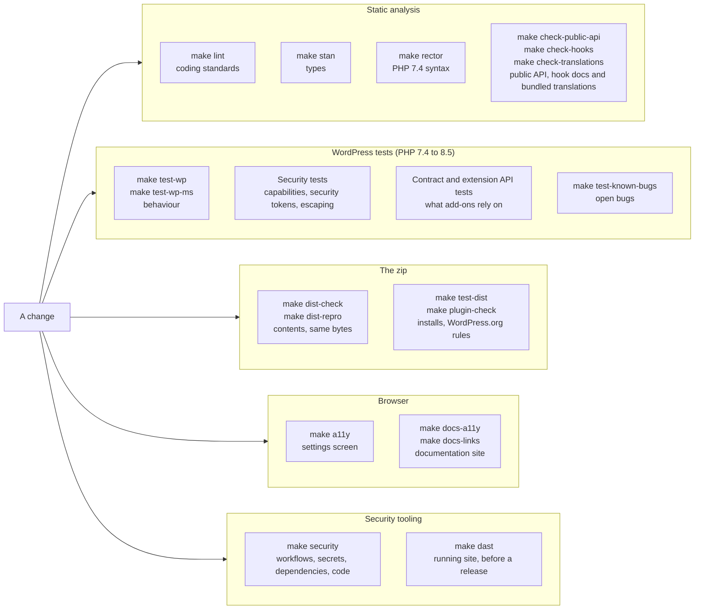

# Tests and checks

The plugin has several layers of tests and checks. Each one catches a different kind of mistake, and each one runs with a `make` target in Docker, so you need only Docker and `make`. `make test` runs the WordPress suites (single site and multisite) and the release script tests. The other layers have their own targets.

CI runs every target in the diagram on pull requests, except `make dast`. It takes about 11 minutes, so you run it yourself before a release.

## WordPress tests

**Covers.** Behaviour of the plugin inside a real WordPress: the update check, scheduling, settings and validation, channels and routing, the email channel, the settings screen markup, upgrades from older versions and uninstall. WordPress, its test library and a database come from the Docker setup. Mail and HTTP are faked.

**Lives in.** `tests/wp/`, one `test-*.php` file per area, on `tests/wp/class-wpun-test-case.php`. Add a file there and it runs: they are found by name.

**Run it.** `make test-wp` for a single site, `make test-wp-ms` for multisite. Pass PHPUnit options with `ARGS`, for example `make test-wp ARGS="--filter Test_Routing"`. `PHP_VERSION` and `WP_VERSION` pick the versions.

**CI.** The `wordpress` job in `ci.yml` runs PHP 7.4 to 8.5 on WordPress 7.1.3, single site and multisite, and PHP 7.4 and 8.3 on WordPress 6.7.9, the oldest supported. The `wordpress-trunk` job runs the suite against WordPress trunk every night, on PHP 7.4 and 8.5.

## Security tests

**Covers.** Hostile input and access control: the capability and security token matrix for every admin action, stored and reflected cross-site scripting through names, versions, URLs and settings, secrets that must never reach the page or a log, malformed settings input, and outbound requests. These tests back the [threat model](../security/threat-model.md).

**Lives in.** `tests/wp/security/`, in the `security` PHPUnit group. They are found automatically, so a new admin action or setting gets a new test in this folder, not a change to a list.

**Run it.** They run with the rest of the WordPress tests. To run only them: `make test-wp ARGS="--group security"`.

**CI.** The same `wordpress` jobs as above.

## Known-bug tests

**Covers.** A bug that is open and has a test. The test asserts the correct behaviour, so it fails until the bug is fixed.

**Lives in.** `tests/wp/test-known-bugs.php`. A test is tagged `@group known-bug` while its bug is open. `phpunit.xml.dist` leaves that group out of the normal run, so CI stays green. The fix removes the tag, and the test then runs with everything else and guards against the bug coming back. The group can be empty, which means no known bug has a test waiting.

**Run it.** `make test-known-bugs` runs only the tagged tests. They are expected to fail.

**CI.** No. They are excluded on purpose.

## Contract and extension API tests

**Covers.** What other code depends on. The contract tests pin the names and behaviour that existing sites and add-ons use: option names, hook names, the public classes. The extension API tests load a fixture add-on that uses every extension point (channels, item types, routing, configuration sources, the API version check) and the example channel from `examples/`, so the documented way to extend the plugin is exercised as an add-on author would use it. Changing one of these tests needs an upgrade path and a changelog entry.

**Lives in.** `tests/wp/test-contract.php`, `tests/wp/test-extension-api.php` and `tests/wp/test-example-channel.php`. The fixture add-on is in `tests/fixtures/plugins/wpun-test-addon/`.

Two checks guard the same boundary without WordPress. `make check-public-api` fails if a module, the example channel or the fixture add-on uses anything that is not public API. `make check-hooks` fails if a hook the plugin fires has no doc block with `@since`, or if the [hook reference](hooks.md) is stale (`make hook-docs` rewrites it). Both have their own tests in `tests/bin/`, which the targets run first, so a checker that stopped finding problems would fail too.

`make check-translations` guards the bundled translations: it fails if a `.l10n.php` file has a string of the code untranslated, a fuzzy or obsolete entry, a broken placeholder, wrong plural forms, or is not byte for byte what the translations and the code build (a hand edit, or a changed string). It also fails when WP-CLI warns about a string, and on any other file in `languages/`. So a change to a string needs a translation session before CI is green. Its exporter has its own test in `tests/bin/`, which the target runs first. See [Translations](translations.md).

**CI.** The tests run in the `wordpress` jobs. The checks run in the `phpcs` job of `lint.yml`.

## Static analysis

**Covers.** Mistakes found without running the code.

- `make lint` runs PHP_CodeSniffer with the WordPress Coding Standards on the plugin, the example add-on and the field showcase. Warnings fail it too.
- `make stan` runs PHPStan with the WordPress stubs. `phpstan-baseline.neon` lists the findings that are accepted for now. It may only shrink: fix a new finding, or annotate it with a reason.
- `make rector` is a dry run that shows any PHP 7.4 syntax upgrade Rector would make. It changes nothing. It fails when the code is behind.
- `make taint` (Psalm) and `make sast` (Semgrep) are in [security tooling](#security-tooling).

**Lives in.** `phpcs.xml.dist`, `phpstan.neon.dist`, `rector.php` and `phpstan-baseline.neon` in the repository root.

**CI.** `phpcs` in `lint.yml` (with the two checks above), and the `phpstan` and `rector` jobs in `ci.yml`.

## Packaging

**Covers.** The zip that users install, as opposed to the repository.

- `make smoke` checks PHP, the `mysqli` extension and that every PHP file lints. `make matrix` does it on every supported PHP version.
- `make dist` builds `build/wp-updates-notifier-<version>.zip` with the runtime files only. `make dist-check` fails if the contents are not on the allowlist, a required file is missing or the version is wrong.
- `make dist-repro` builds the zip twice from fresh clones, with a different umask, file times and time zone, and fails if the SHA-256 differs.
- `make test-dist` installs the zip into a fresh WordPress, then activates, deactivates and uninstalls it.
- `make plugin-check` runs WordPress.org's Plugin Check on the zip. `make check-headers` generates `readme.txt` (it is not committed; edit `.wordpress-org/readme/`, `docs/users/troubleshooting.md` and `CHANGELOG.md`, see `make readme`) and checks that it agrees with the plugin header and follows WordPress.org's rules. `make test-readme` tests the generator and those checks.
- `make blueprint` generates the WordPress Playground blueprint (the WordPress.org Live Preview, `build/blueprint.json`; it is not committed) from `.wordpress-org/blueprint/` with `bin/blueprint.php`. `make check-blueprint` validates it against the Playground blueprint schema vendored in `tests/bin/blueprint/` (Ajv in a pinned node image) and checks that the landing page is the settings screen and no `@file:` placeholder is left. `make test-blueprint` tests the generator (deterministic, missing and unused files) and that the schema check rejects broken blueprints.
- `make test-release` rehearses the scripts the release workflow runs: the copyright year and the signed commit request.

**Lives in.** `bin/` for the scripts, `tests/bin/test-release-scripts.sh` for the release rehearsal.

**CI.** `ci.yml` has a job for each: `smoke` (every PHP version), `dist` (PHP 7.4 and 8.5, which also runs `make test-dist`), `dist-repro`, `plugin-check` (with `check-headers`, `test-blueprint` and `check-blueprint`) and `release-scripts`.

## Browser checks

**Covers.** Accessibility in a real browser, with Playwright and axe: WCAG 2.2 A and AA, and keyboard use.

- `make a11y` checks the settings screen on a throwaway WordPress site (its own Compose project, so it never touches `make up`). Specs are in `tests/e2e/specs/`.
- `make screenshots` is not a test: it regenerates the WordPress.org screenshots (`.wordpress-org/screenshot-1.png` to `4`) on a throwaway site of its own (compose project `wpun-shots`, files in `tests/screenshots/`), with made-up data and the update email caught by Mailpit. It fails if the update check did not send. Run it before a release; CI does not.
- `make blueprint-smoke` runs the generated Playground blueprint in WordPress Playground CLI (compose project `wpun-playground`, files in `tests/blueprint-smoke/`; it never touches `make up`), with the plugin taken from the zip of `make dist` instead of WordPress.org. Playwright then checks that the settings screen shows the demo notice, the Channels tab shows two deliveries as sent, and Tools → Demo emails lists the update emails with the made-up plugins. Playground downloads WordPress on every run, so it needs the network. Run it before a release; CI does not.
- `make docs-a11y` builds this documentation site and checks every page in the dark and the light scheme: axe, no request to a third party, visible keyboard focus, and that every Mermaid diagram parses. A syntax error in a diagram fails it, because Mermaid would otherwise draw an error image and the page would still load. Specs are in `tests/e2e/docs/specs/`.
- `make docs-links` checks the links in the built site and in `README.md`, the generated `readme.txt` and `CONTRIBUTING.md` with lychee, including links to other sites. Internal links and anchors are already checked by the strict `make docs` build.

**CI.** The `a11y` job in `ci.yml`. The `docs` and `links` jobs in `docs.yml`. The `links` job also runs every week, because links to other sites break without a change here.

## Security tooling

**Covers.** The things the PHP tests cannot see: the workflows, committed secrets, vulnerable dependencies, unsafe code patterns and the running site.

`make security` runs all of these (except `make dast`), each also a job in `security.yml`:

- `make check-workflows`: actionlint (with shellcheck) and zizmor, job `workflows`.
- `make secrets`: gitleaks over the history, the working tree and the built zip, job `secrets`.
- `make audit`: `composer audit` and OSV-Scanner over every lockfile, job `dependencies`.
- `make sast`: Semgrep with the plugin's own rules in `.semgrep/`, with tests for the rules and a check that every suppression gives a reason, job `sast`.
- `make taint`: Psalm taint analysis from untrusted sources to unsafe output, job `taint`.

CI also runs a dependency review on pull requests and Trivy over the images (`make audit-images`, report only). The workflow runs weekly too, because new advisories appear without a change here.

`make dast` runs OWASP ZAP against a throwaway copy of the site and fails on any Medium or High alert. It takes about 11 minutes, so CI does not run it. Run it before merging a Release PR. Its files are in `tests/dast/`.

See [CONTRIBUTING](https://github.com/l3rady/wp-updates-notifier/blob/main/CONTRIBUTING.md) for the rules on suppressions, baselines and pinned tools.
