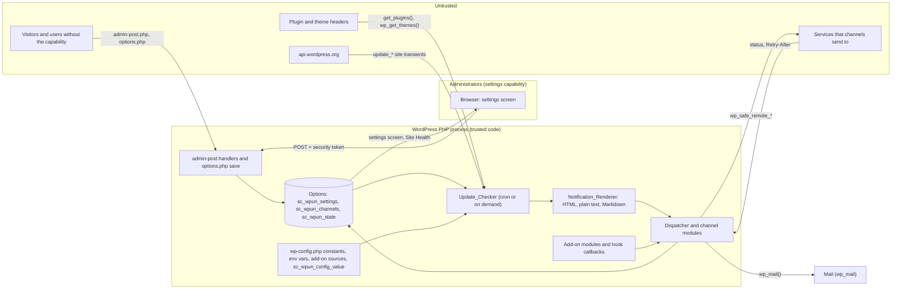

# Threat model for 2.0.0

What WP Updates Notifier trusts, where untrusted data crosses into it, what stops each threat, and the test or tool that
proves the control holds. The security audit for 2.0.0 (#228) checks the code against this document, and the
AI-assisted review (#230) reads it as context. When a change adds an entry point, a source of data or an outbound
channel, update this document in the same pull request.

Threats are grouped by [STRIDE](https://learn.microsoft.com/en-us/azure/security/develop/threat-modeling-tool-threats):
**S**poofing, **T**ampering, **R**epudiation, **I**nformation disclosure, **D**enial of service and
**E**levation of privilege. Tests are in `tests/wp/`. Tools are `make` targets, and CI runs each of them on every pull
request (`.github/workflows/`). The security tests are in `tests/wp/security/` (#220), and the OWASP ZAP scan is `make dast` (#222).

## Scope and assumptions

- **WordPress core is trusted.** That covers login, sessions, `current_user_can()`, security tokens (`wp_verify_nonce()`), `options.php`,
  `wp_mail()`/PHPMailer, the HTTP API's `wp_safe_remote_*` checks and the cron runner. A flaw in core is out of scope.
- **Administrators are trusted** with what an administrator can already do in WordPress. Here that means anyone with the
  settings capability: `manage_options` by default, or whatever the `sc_wpun_capability` filter returns. On multisite
  that is a site administrator, and the plugin keeps settings per site.
- **Code that runs in the same PHP process is trusted.** That covers other plugins, the theme, add-on channel modules,
  `wp-config.php` and anything hooked into the plugin's filters. Such code can already do anything the plugin can, so the
  public API does not try to sandbox it. What the plugin owes add-ons is a safe API when it is used as documented: secrets
  stay redacted, values are validated, and one broken module can't stop the others. See
  [Public hook and add-on API](#6-public-hook-and-add-on-api).
- **Untrusted:** every other user role, anyone not logged in, request parameters, plugin and theme headers written by
  third parties, data from api.wordpress.org, and responses from the services a channel sends to.

## Data flow

The trust boundaries are:

- the HTTP request into `admin-post.php` and `options.php`;
- third-party data read from headers and transients;
- outbound requests and the responses that come back;
- the settings screen, where stored data is rendered.

## Assets

| Asset | Where it lives | Why it matters |
| --- | --- | --- |
| Channel secrets (webhook URLs, tokens) | `sc_wpun_channels`, or constants and env vars | They let someone post into the site owner's chat or services. |
| Recipient lists, From and Reply-To | `sc_wpun_channels` | Changing them redirects or spoofs the site's mail. |
| Settings and schedule | `sc_wpun_settings`, cron event `sc_wpun_update_check` | Silencing them hides the updates a site needs. |
| Delivery state | `sc_wpun_state` | It holds what was already notified, `last_result` and `retry_at`. |
| The site's update inventory | Sent in notifications | It shows which outdated, possibly vulnerable, plugins a site runs. |
| The release zip | GitHub release, WordPress.org SVN | A tampered build reaches every site that updates. |

## Entry points

### 1. admin-post handlers

All are registered in `Plugin::register_admin_hooks()` (`includes/class-plugin.php`), except the Slack notice dismiss,
which `Plugin` registers next to the notice. There are no `admin_post_nopriv_*`, `wp_ajax_*` or REST routes.

| Action | Handler | Token action | Method |
| --- | --- | --- | --- |
| `sc_wpun_send_test` | `Channels_Tab::handle_test_send` | `sc_wpun_send_test_<id>` | POST |
| `sc_wpun_channel_toggle` | `Channels_Tab::handle_toggle` | `sc_wpun_channel_toggle_<id>` | POST |
| `sc_wpun_channel_duplicate` | `Channels_Tab::handle_duplicate` | `sc_wpun_channel_duplicate_<id>` | POST |
| `sc_wpun_channel_delete` | `Channels_Tab::handle_delete` | `sc_wpun_channel_delete_<id>` | POST |
| `sc_wpun_check_now` | `Check_Now::handle` | `sc_wpun_check_now` | POST |
| `sc_wpun_save_channel` | `Channel_Form::handle_save` | `sc_wpun_save_channel_<new\|edit>_<type\|id>` | POST |
| `sc_wpun_dismiss_slack_notice` | `Slack_Notice::handle_dismiss` | `sc_wpun_dismiss_slack_notice` | GET (link) |

**Trust boundary:** any HTTP client can reach `admin-post.php`. Unauthenticated requests fire only `admin_post_nopriv_*`,
and the plugin registers none. The Semgrep rule `wpun-no-nopriv-hooks` (`make sast`, #216) fails the build if one is added.

| STRIDE | Threat | Control | Proof |
| --- | --- | --- | --- |
| E | A user without the capability changes channels, sends messages or runs the check. | Each handler checks `current_user_can( Settings_Page::capability() )` first, and refuses with a 403 and no change. | `test-channels-tab.php` (`test_nonce_and_capability_are_enforced_for_every_action`), `test-channel-form.php` (`test_nonce_and_capability_are_required`, `test_refusals_change_nothing`, `test_the_handler_answers_403_when_refused`), `test-check-now.php` (`test_a_refused_request_runs_nothing`), `test-test-send.php`, `test-slack-notice.php`. `security/test-capability-matrix.php` (#220): discovers every `admin_post_*`/`wp_ajax_*` hook the plugin registers, fails on one without a request builder, and sends each one ten refused requests: logged out, subscriber, editor, administrator without `manage_options`, and administrator with no, empty, other-action, other-channel or other-user token, or the fields in the wrong method. Each must die with 403 and change nothing (options, user meta, mail, HTTP), with a positive control. The unauthenticated ZAP pass (`make dast`, #222). |
| S/T | CSRF: another site makes an administrator's browser post the action. | A security token per action. Row actions and the form bind it to the channel id (and the mode and type), so a token for one channel can't act on another. | The tests above. `security/test-capability-matrix.php` (#220) covers the wrong-action, other-channel and other-user tokens for every hook. |
| T | Tampered `id`, `mode` or `type` reaches the store. | `sanitize_key( wp_unslash() )` and `is_string` checks. Unknown ids and types are refused, and code-defined and externally set instances have no row actions. | `test-channels-tab.php`, `test-channel-form.php`. |
| T | Open redirect after the action. | Redirects use `wp_safe_redirect()` to the settings page. | WPCS `WordPress.Security.SafeRedirect` (`make lint`). #222 checks the redirect targets. |
| R | An administrator denies changing a channel. | Not addressed. WordPress has no audit log, and the plugin doesn't add one. Accepted for 2.0.0. | n/a |
| D | Repeated Check now or test sends flood a mail service. | Capability and security token limit this to administrators, who are trusted. | As above. |

The dismiss link is a GET that changes state, but only the current user's own meta (`sc_wpun_dismissed_slack_notice`). It
still needs the security token and the capability.

### 2. The settings screen

The General tab saves through core's `options.php` (`register_setting` with `sc_wpun_settings_validate`, and
`option_page_capability_sc_wpun_settings` returns the same capability). The Channels tab and the channel form use the
handlers above. Field types are in `includes/class-field-types.php`, `class-boolean-field.php` and
`class-enum-field.php`. They render through `includes/admin/class-field-renderer.php`.

**Trust boundary:** administrator input in, and stored, external and add-on data rendered back out.

| STRIDE | Threat | Control | Proof |
| --- | --- | --- | --- |
| E | Someone without the capability opens the page. | `Settings_Page::settings_page()` refuses with a 403. Core's options.php checks the filtered capability. | `test-settings-screen.php` (`test_the_page_refuses_users_without_the_capability`). |
| T | Invalid or hostile values are stored. | Each field type sanitises and validates. Text uses `sanitize_text_field`. URLs need an `http` or `https` scheme and pass `esc_url_raw`. Email lists go through `sanitize_email` and `is_email`. Numbers are bounded, enums are allowlisted, and only declared fields are kept. Unknown notify keys and frequencies are refused. | `test-field-types.php`, `test-settings-validation.php`, `test-boolean-field.php`, `test-enum-field.php`, `test-field-showcase.php`. `security/test-settings-input.php` (#220): hostile payloads through every field type, for the email schema and an add-on schema, and `javascript:`, `data:` and `file:` URLs. ZAP fuzzes the field showcase (`make dast`, #222). |
| I | Stored XSS through a field value, an error message or a channel's last result. | Late escaping (`esc_html`, `esc_attr`, `esc_url`) in the renderer and tabs, checked by WPCS's `WordPress.Security.EscapeOutput`. Psalm follows options and transients to `echo`. | `test-settings-markup.php`, `test-channel-form.php` (`test_an_error_without_a_field_is_plain_text`), `make lint`, `make taint` (#218). `security/test-stored-xss.php` (#220): payloads in every tab and form, the reflected `tab`, `action`, `id` and `type` parameters, and the channel list with its last result. |
| I | A secret is shown on the page. | Secret fields are never rendered: the renderer only learns whether a value is saved (`'1'`/`''`). An empty input keeps the stored value, and `<name>__clear` removes it. `secret => true` works on any type. Values set in code show as read-only and are never echoed unless the schema opts in with `show_external`, which email uses for its non-secret fields only. | `test-field-types.php` (`test_render_secret_never_outputs_value`, `test_secret_keep_and_clear`, `test_secret_flag_on_other_types`), `test-channel-form.php` (`test_secrets_are_never_output_and_can_be_kept_or_cleared`, `test_secrets_are_not_kept_for_the_error_round_trip`), `test-channels-tab.php` (`test_duplicate_does_not_store_external_secrets`). `security/test-secrets.php` (#220): a secret set through the form, a constant and an env var never shows, apart from the placeholder or its source. |
| E | An add-on schema renders unescaped markup. | Add-on code is trusted (see Scope). Its custom `render` callbacks are its own responsibility. | `docs/developers/writing-a-module.md`. |

### 3. Update data

Plugin and theme names, versions, authors and URLs come from third-party headers (`get_plugins()`, `wp_get_themes()`)
and from api.wordpress.org through the `update_core`, `update_plugins` and `update_themes` site transients
(`includes/class-update-checker.php`). They become `Notification_Item` values and are rendered as HTML email, plain
text or Markdown (`includes/class-notification-renderer.php`), as well as in the update nag and Site Health.

**Trust boundary:** third-party strings in, and markup out.

| STRIDE | Threat | Control | Proof |
| --- | --- | --- | --- |
| T/I | A plugin name such as `<script>…` or `">` runs in HTML mail or an admin page. | `Notification_Item` collapses control characters so each value is a single line. The HTML renderer escapes every value with `esc_html` or `esc_url`. Markdown escapes its special characters and links only explicit `http(s)` URLs. Plain text is not HTML, and it is sent as `text/plain`. | `test-notification.php` (`test_html_escapes_values`, `test_markdown_escapes_special_characters`, `test_markdown_drops_unsafe_link_targets`, `test_plain_text_is_not_escaped`), `test-message-snapshot.php`, `make taint` (sources `get_plugins`, `get_plugin_data`, `wp_get_themes`, `get_site_transient`). `security/test-stored-xss.php` (#220): the payloads through a mocked update check into the HTML and plain-text mail (no live markup, no double encoding), the nag, the channel list, Site Health and every tab. |
| T | A `javascript:` link in a header reaches a notification. | `esc_url` in HTML, and the `http(s)`-only rule in Markdown. | `test-notification.php`. `security/test-stored-xss.php` (#220). |
| D | Huge or many items blow a channel's size limit. | Renderer limits truncate and summarise. | `test-renderer-limits.php`. |
| I | The update inventory leaks to someone who shouldn't see it. | It goes only to recipients and channels an administrator set up. The `hide_updates` setting removes the nag for users who can't `update_core`. | `test-update-nag.php`, `test-routing.php`. |

Two things the security tests found are out of scope or accepted:

- WordPress core's own update nag prints the `update_core` version without escaping. That is core's output, not the
  plugin's, and the plugin adds nothing to the nag.
- A right-to-left override (U+202E) in a plugin name survives into the mail and the admin. It can make a name display
  misleadingly, but it can't inject markup. Accepted.

### 4. Configuration sources

Any setting or channel field can come from a `wp-config.php` constant (`SC_WPUN_SETTING_<NAME>`,
`SC_WPUN_CHANNEL_<ID>__<FIELD>`) or from an environment variable. Environment variables are off unless
`SC_WPUN_LOAD_FROM_ENV` or the `sc_wpun_load_from_env` filter turns them on. Add-ons can register sources with
`sc_wpun_config_sources`, and the `sc_wpun_config_value` filter has the last word (`includes/class-config.php`).

**Trust boundary:** none to the outside. All of these are server-side and trusted. The risks are values that are
malformed or leak.

| STRIDE | Threat | Control | Proof |
| --- | --- | --- | --- |
| T | A malformed value breaks a channel or bypasses validation. | Every value is cast to the field's type and validated like form input. A rejected value is not used anywhere and is listed, without the value, in Site Health. A throwing or junk source is skipped. | `test-config.php` (`test_precedence_for_a_setting`, `test_a_throwing_source_is_skipped`, `test_a_junk_source_is_dropped`), `test-config-channels.php` (`test_a_rejected_value_is_not_used_anywhere`). |
| I | A secret from wp-config or the environment shows up in a page, a log, Site Health or debug output. | `Config_Value` hides secret values in debug output and string casts. `Channel_Instance::__debugInfo` redacts. Reports name only the source, never the value. External values are read-only on the form. | `test-config-channels.php` (`test_a_secret_never_leaks`, `test_a_valid_secret_is_used_and_not_logged`), `test-config.php` (`test_external_settings_render_read_only`). `security/test-secrets.php` (#220): Site Health debug data, `_doing_it_wrong` messages, notices, the debug log and `print_r`/`var_dump` of an instance. |
| E | An add-on uses the source API to override another plugin's values. | Add-ons are trusted (see Scope). The order of precedence is documented and fixed. | `docs/developers/configuration-sources.md`. |

### 5. Outbound requests

Email is the only built-in channel, and it sends with `wp_mail()`. HTTP channels come from add-ons. The example add-on
(`examples/wpun-example-channel/`) shows the expected pattern: `wp_safe_remote_post()`, a timeout, and
`Delivery_Result` failures that leave out the address. `Retry-After` from a response is parsed by
`Delivery_Result::retry_after_from_response()`. It is capped at 7 days (`State::MAX_RETRY_AFTER`), and it defers only
that instance.

| STRIDE | Threat | Control | Proof |
| --- | --- | --- | --- |
| I/E | SSRF: a channel URL points at `127.0.0.1`, `169.254.169.254` or the LAN. | `wp_safe_remote_*` refuses private and loopback hosts unless the site allows them with core's `http_request_host_is_external` filter. URL fields accept only `http(s)`. The Semgrep rule `wpun-outbound-http-safe-only` refuses `wp_remote_*` and other HTTP clients in the plugin and the example. Psalm treats `wp_safe_remote_*` URLs as SSRF sinks. | `make sast` (#216), `make taint` (one baselined, reviewed finding in the example add-on), `test-example-channel.php`. `security/test-outbound-requests.php` (#220): every request of the example add-on carries `reject_unsafe_urls`. Loopback, link-local (metadata), private and IPv6 loopback addresses are refused, and only a host the site allows passes. The email module makes no HTTP request. |
| D | A service answers `Retry-After: 99999999` or garbage and silences the channel for good. | The header is parsed strictly, the wait is capped at a week, and the cap is per instance. | `test-retry-after.php`. |
| I | An error message or `last_result` leaks the webhook URL. | The example's failures leave out the address, and the [module guide](../developers/writing-a-module.md#secrets) tells add-ons never to put a secret in a result, notice or log, nor to pass on the HTTP API's error messages as they are. | `test-example-channel.php` (`test_a_wp_error_is_a_failure_without_the_address`). `security/test-secrets.php` (#220) checks `last_result` and the delivery state. |
| T | Mail header injection through the From name, the subject, the recipients or the payload filters. | Recipients and header lines with CR or LF are dropped after the payload filters (`Email_Channel::checked_payload`). The subject is built from `sanitize_text_field` values, and PHPMailer encodes it. From and Reply-To are validated email settings. | `test-hooks.php` (header lines with line breaks are dropped), `test-email-channel.php`. #228 re-checks this by hand. |

### 6. Public hook and add-on API

Add-ons register channel modules, item types and config sources, and they hook the documented actions and filters
(`docs/developers/hooks.md`). Modules declare the API version they need, and a module that needs a newer one is
refused, with a notice for administrators.

What an add-on is trusted to do: run any PHP, read and send its own channel's settings, change payloads through the
filters, and supply config values. What the plugin still guarantees when an add-on is used as documented:

- a module's secrets are never rendered or logged by the plugin;
- schema values are sanitised and validated before the module sees them;
- an exception in one module becomes a failed `Delivery_Result` and doesn't stop the other channels;
- payload filters can't inject mail headers (see 5);
- the capability for the screens comes from one filter, `sc_wpun_capability`, and a non-string or empty value falls back to `manage_options`.

Proof: `test-extension-api.php`, `test-dispatcher.php`, `test-channel-api-constraint.php`, `test-api-version.php`,
`test-contract.php`, `make check-public-api` (modules use only the public API), and `make check-hooks` (every hook is
documented).

### 7. Cron and on-demand runs

`sc_wpun_update_check` (WP-Cron) and `sc_wpun_run_check` (on demand, for example from WP-CLI) both run
`Update_Checker`. Check now (1) calls the same code after its capability and security token checks.

| STRIDE | Threat | Control | Proof |
| --- | --- | --- | --- |
| D/T | Overlapping runs, such as cron and Check now together, deliver the same update twice. | **Accepted trade-off:** there is no lock. A duplicate message is harmless, and a lock adds failure modes, such as a stale lock that silences notifications. | n/a (recorded decision) |
| E | Anyone triggers a run. | Visitors can only trigger WP-Cron at its schedule, never on demand. `sc_wpun_run_check` is an action for trusted code only. | `test-run-check.php`, `test-scheduling.php`, `test-check-now.php`. |

### 8. Stored data

These options are stored per site: `sc_wpun_settings`, `sc_wpun_settings_ver`, `sc_wpun_channels` and `sc_wpun_state`.
There is also user meta for notices and form round trips. **Secrets are stored in plain text in the options table**,
like every WordPress plugin's. Anyone who can read the database or run code can read them. A site that wants them out
of the database sets them in `wp-config.php` constants or environment variables (4).

| STRIDE | Threat | Control | Proof |
| --- | --- | --- | --- |
| I | Secrets leak through `var_dump`, `print_r` or debug plugins. | `Channel_Instance::__debugInfo` and `Config_Value` redact. | `test-notification.php`, `test-config-channels.php`. |
| I | Data is left behind after uninstall. | `uninstall.php` deletes every option, transient, user meta key and cron event, on every site of a network. | `test-uninstall.php`, `make test-dist` (install, activate, deactivate, uninstall). |
| T | Options changed directly or by another plugin hold invalid data. | Values are checked again when read: the store skips invalid instances and missing settings get their defaults. | `test-channel-store.php` (`test_invalid_entries_are_skipped_on_read`), `test-settings-state.php` (`test_missing_settings_get_defaults`). |

### 9. Build and release

The release zip is built by `bin/build-dist.sh` from the files `.distignore` doesn't exclude, and the build is
reproducible. release-please opens the release PR with a GitHub App token and, when it is merged, makes a draft release
with no tag. The `release` job then runs in the `release` environment, which is limited to `main` and needs the
maintainer's approval. It builds the zip and its SBOM, attests the zip's provenance and SBOM, creates a signed annotated tag at the release
commit, uploads the assets and publishes the release. The WordPress.org deploy (#57, not built yet) will run on the
published release in the `wordpress-org` environment, which needs a reviewer.

| STRIDE | Threat | Control | Proof |
| --- | --- | --- | --- |
| T | A malicious or compromised workflow, action or tool image. | Actions and tool images are pinned by digest. Workflows default to `permissions: {}` or read-only, and credentials aren't persisted. `CODEOWNERS` covers `.github/` and `bin/`. Dependabot waits 14 days before proposing a new release. | `make check-workflows` (actionlint, zizmor, #210), OpenSSF Scorecard (#224). |
| T | A vulnerable dependency. | Runtime code has no dependencies (`make dist-check` enforces it). Development dependencies are audited. | `make audit` (composer audit, OSV-Scanner), dependency review on PRs, `make audit-images` (Trivy), all #214. |
| I | A committed secret. | Secrets live outside the repo. gitleaks scans the history, the tree and the zip. | `make secrets` (gitleaks, #212). |
| T | Unreviewed changes on `main`. | Branch protection: PRs, signed commits, linear history and the required checks. | Scorecard Branch-Protection (#224). The accepted gaps are in `SECURITY.md`. |
| S/T | A tampered zip on GitHub. | The zip is reproducible from the tag. The release job attests its build provenance and its SBOM, and checks the attestation before it publishes. | `make dist-repro` on every PR, `gh attestation verify` in the release job (#226). |
| S/T | A forged or moved release tag. | Tags are annotated and signed with a dedicated SSH key, held in the `release` environment. The `v*` ruleset forbids updating or deleting them. A re-run reuses the tag only if it points at the release commit and its signature checks out against `.github/release-signers`. | `make test-release` (`bin/sign-release-tag.sh`), the `release tags` ruleset (#224, #226). |
| S/T | A tampered zip on WordPress.org. | **Not yet.** Planned: the deploy runs only after the attestation of the zip it deploys checks out. | #57. |

## Follow-ups

- #57: the WordPress.org deploy, gated on the attestation.
- #228: the audit sign-off against this model.
- #230: the AI-assisted review, re-run with this document as context.
